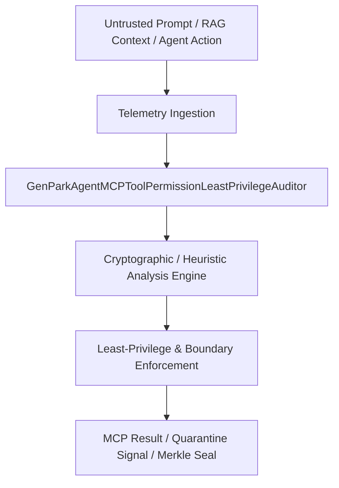

# genpark-agent-mcp-tool-permission-least-privilege-auditor-skill

[](https://github.com/Alpha-Park)
[](https://modelcontextprotocol.io)
[](requirements.txt)
[](#)
[](#)
[](LICENSE)

Production-hardened Agentic Cybersecurity & Red-Teaming skill with a standard-library client and an MCP SDK server. Provides real-time injection fuzzing, exfiltration canary detection, least-privilege tool sandboxing, and cryptographic audit proofs via the Model Context Protocol (MCP).

---

## Architecture & Data Flow



---

## Quickstart & Usage

### 1. Direct Python Client Execution
```bash
python example_usage.py
```

### 2. Standalone MCP Server Launch

The core Python client uses only the standard library. Running the MCP server requires **Python 3.10+** and the official **`mcp>=1.0.0,<2` SDK**. From the repository directory:

```bash
python -m venv .venv
.venv/bin/python -m pip install -r requirements.txt
```

On Windows, use `.venv\Scripts\python.exe` instead. Configure the MCP client to use this environment's Python executable. The server runs locally over stdio; the GitHub repository URL is not a remote MCP endpoint.

Run the native STDIO MCP server:
```bash
.venv/bin/python mcp_server.py
```

---

## License

This project is licensed under the MIT License - see the [LICENSE](LICENSE) file for details.
